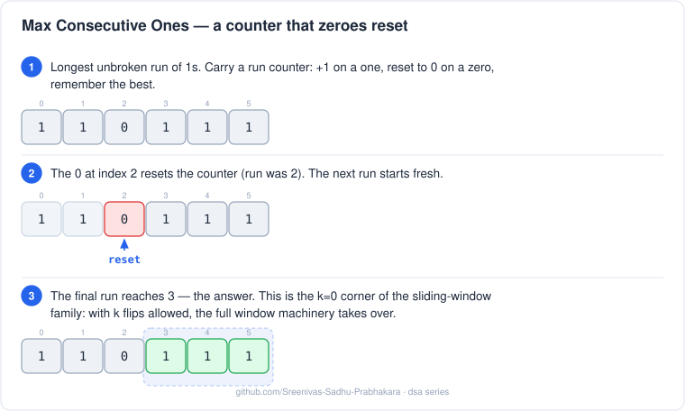

# Max Consecutive Ones

> Striver SDE Sheet 042 · Day 7 LL & Arrays — a running counter reset by zeroes; the simplest possible sliding window. Go, stdlib only, tested.

## Problem

In a binary array, find the length of the longest unbroken run of 1s.

## Approach

Carry a run counter: increment on 1, reset on 0, track the best seen. That's the entire algorithm — the problem earns its sheet slot as the degenerate case of the sliding-window family (its famous sibling, "max consecutive ones with k flips allowed", needs the full window machinery; with k = 0 the window collapses to this counter).

**Complexity:** O(n) time, O(1) space.

## Visual walkthrough

Read the picture top to bottom — each numbered frame is one moment of the algorithm
running on this repo's test example.

## Run

    go test ./...   # verify
    go run .        # demo

---

One of 191 repos solving Striver's SDE Sheet in Go — stdlib only, one problem per repo, every solution tested. Browse the set: [`dsa-*` repos](https://github.com/Sreenivas-Sadhu-Prabhakara?tab=repositories&q=dsa-&type=source).
